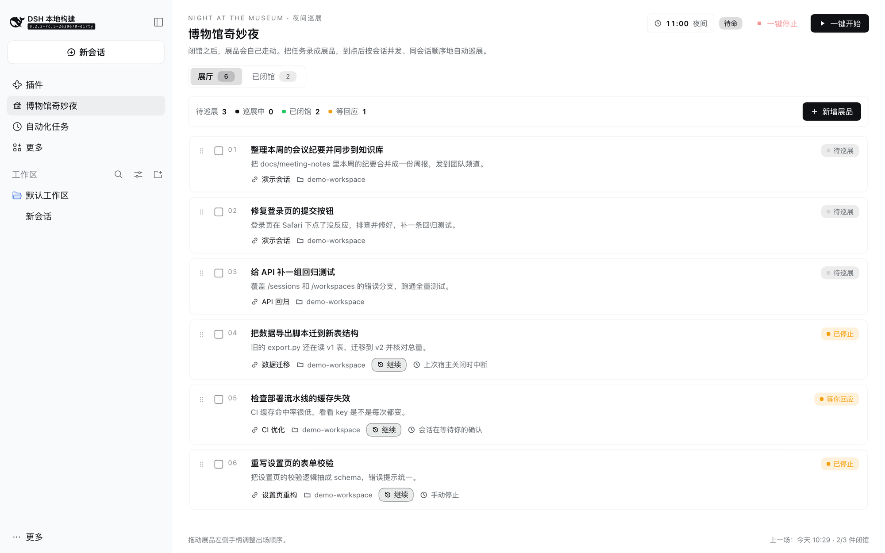
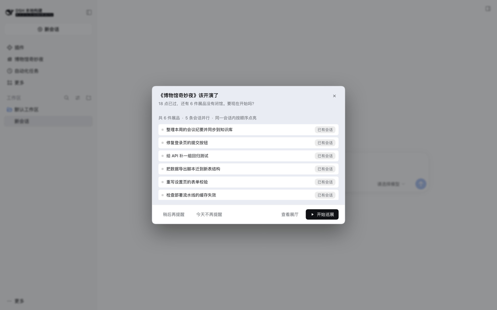
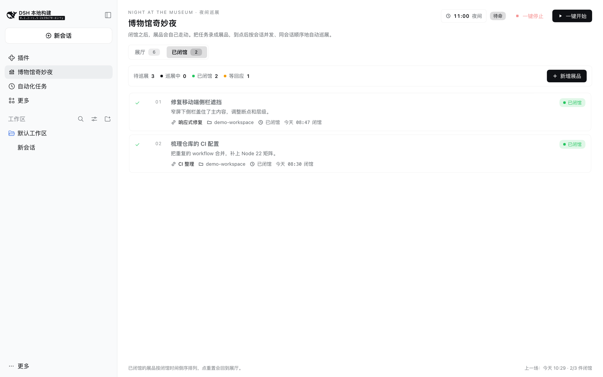

# 博物馆奇妙夜 · Night at the Museum

一个 DeepSeek Harness Web 插件：把晚上的任务录成「展品」，到点后按会话并发、同会话顺序地自动巡展。

A nocturnal task museum for DeepSeek Harness: queue tasks as exhibits, run them on demand or after 18:00, with per-session concurrency and in-order sequencing.



## 它做什么

- **左侧入口**：侧栏多一个《博物馆奇妙夜》图标，点开就是展厅（展品列表）。
- **录入展品**：写一条任务内容，选择它落到哪个会话：
  - **选择已有会话**：从当前会话列表里挑一个，工作区自动带出；
  - **新增会话**：挑选一个工作区，巡展开始时在该工作区新建会话；这个会话之后一直沿用，
    后续巡展和「继续」都在里面做，不会每轮另开一个。
- **展厅 / 已闭馆两个 tab**：主列表「展厅」只放还没闭馆的展品；巡展跑完的展品会收进「已闭馆」tab，按闭馆时间倒序排列。已闭馆的行不能拖动、没有勾选，点重置会回到展厅并自动切回「展厅」tab。
- **排顺序**：拖动展品左侧的手柄调整出场顺序，顺序会持久保存。
- **18:00 自动提醒**：到点后若还有未闭馆的展品，右下角浮层会问要不要开始；可以「稍后再提醒」（30 分钟）或「今天不再提醒」。



- **一键开始**：右上角随时手动开演。若当前是峰时（周一至周五 9:00–12:00、14:00–18:00），确认弹窗会额外提醒一次。
- **半途继续**：停下来的展品（已停止 / 出岔子 / 等你回应）行内会出现「继续」，点它并确认后，
  会往这件展品原来的会话里发一句「继续」，上下文就在那个会话里。
- **等你回应不是终点**：会话在等你确认（审批/提问）时，展品会显示「等你回应」，整场巡展**继续挂着**；
  你在会话里回应之后，它自动回到「巡展中」接着等结果，不会卡死在「等你回应」。等你的这段时间
  不计入 3 小时硬期限。
- **换新会话**：「新增会话」模式的展品在展厅里（待巡展 / 已停止等）时，行内的换会话按钮可以让它下次巡展开一个干净的新会话。
- **投递内容**：发到会话里的消息就是展品内容本身，不加标题、不加任何前后缀说明；「继续」只发一句「继续」。
- **并发规则**：不同会话同时跑，同一会话内严格按展品顺序排队。
- **一键停止**：列表里勾选正在巡展（含正在等你回应）的展品（不勾就是全部），点「停止选中」/「一键停止」，
  会中断这些会话当前这一轮。
- **状态与跳转**：每件展品显示「待巡展 / 巡展中 / 已闭馆 / 出岔子 / 已停止 / 等你回应」，点关联会话名可以直接跳到那个会话。
- **结束提示音**：整场巡展结束后浮层会响一段五音提示，并短暂显示结果摘要。
- **配色**：全部走 DSH 主题变量（`--dsw-alias-*`），跟随亮/暗主题。



## 安装

要求 DeepSeek Harness `>= 0.2.0`、Node.js `>= 22`。

从 GitHub 装进 web profile：

```bash
dsh plugin --profile web add github:blackCatYoung/dsh-night-museum
```

或者先把仓库克隆到本地，再装本地目录（改代码时也能直接用 `link:`）：

```bash
git clone https://github.com/blackCatYoung/dsh-night-museum.git
dsh plugin --profile web add /path/to/dsh-night-museum
```

装好后重启 DSH，刷新 Web 页面，左侧出现博物馆图标。

## 状态放在哪

- 展品、顺序、上一场结果：`~/.dsh/night-museum/state.json`（原子写入，跨会话、跨重启保留）。
- 宿主关闭时正在巡展的展品，下次启动会标成「已停止 / 上次宿主关闭时中断」。
- 以「等你回应」状态被关掉时，下次启动会自动对账：你已经回应过、那一轮已经跑完的展品直接标成
  已闭馆；还挂着提问或还没跑完的留在「等你回应」，点「继续」就能接着做。

插件只调用本机 DSH 的会话接口，不上传任务内容，也不额外调用模型；展品在哪个会话里执行，
就沿用那个会话自己的模型和权限配置。

## 结构

```
lib/index.js        插件入口：装配 Museum 并注册路由
lib/util.js         常量与工具（时间、文本、JSON 响应）
lib/museum.js       状态持久化与展品增删改查/排序
lib/schedule.js     巡展编排（并发分组、同会话顺序、期限与停止）
lib/routes.js       /api/night-museum/* 路由

lib/client.js       客户端入口：注入样式、注册侧栏/主面板/浮层三个座位
lib/client.core.js  共享内核：React 引用、API 调用、图标、按钮与弹窗等原子组件
lib/client.forms.js 会话选择、展品表单、开演摘要
lib/client.rows.js  展厅列表行与空状态
lib/client.dialogs.js 展厅的四个弹窗
lib/client.page.js  展厅主页面
lib/client.overlay.js 18 点提醒、结束提示音与结果浮层

icon.svg            侧栏图标
assets/             dsh-market 用的方形图标
docs/screenshots/   README 截图
cordis.patch.yml    安装时插入的 loader 条目
test/smoke.mjs      宿主路由 + 编排的端到端测试（假 sessionController）
test/client-render.mjs 客户端渲染/交互测试（真实宿主路由）
test/harness/       测试基础设施：宿主桥、迷你 React 渲染器、chunk 加载器、固定时钟
```

客户端按 DSH 的包内 chunk 协议拆分：`lib/client.js` 是唯一入口，其余
`lib/client.*.js` 通过 `require.async('./client.x.js')` 在页面打开时按需加载，
彼此用完整模块 id（如 `dsh-night-museum/client.core.js`）共享内核。

## 测试

```bash
npm test                     # 19/19 + 19/19
npm run test:host            # 只跑宿主测试
npm run test:client          # 只跑客户端测试
```

两个脚本都会用临时 `DSH_HOME`，不会碰你的真实展厅。客户端测试会把时钟固定到当天
19:00（`test/harness/clock.mjs`），这样「18:00 提醒」在任何时候跑测试都能覆盖到，
不会出现只在晚上通过的情况。

## 已知边界

- 「新增会话」模式的展品只在第一轮新建会话，之后一直沿用；想重开干净会话时点行内的换会话按钮。
- 会话等你确认（审批/提问）期间，同一会话里排在后面的展品会一起等着——这一轮没有结束，等你回应后会自动继续。
- 巡展中不能编辑或删除该展品，先停止再改。

## License

MIT
